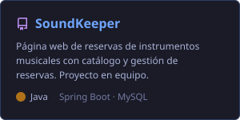
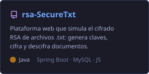
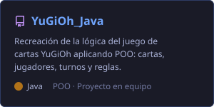

 

## 👋 Hola, soy Alan

Soy estudiante de **Computación en la Escuela Superior Politécnica del Litoral (ESPOL)**, en Ecuador. Me gusta construir la parte del software que no se ve: APIs, lógica de negocio y bases de datos que hacen que una aplicación funcione de forma confiable.

- 🎓 **Formación:** Ingeniería en Computación — ESPOL.
- 🔧 **Enfoque actual:** desarrollo **Backend** con Java y Spring Boot.
- 🤖 **Me interesa:** el diseño de **Agentes de IA** y su integración en aplicaciones reales.
- ⚙️ **Aficionado a:** la cultura **DevOps** — automatización, CI/CD e infraestructura como código.
- 🌱 **Aprendiendo ahora:** desarrollo Frontend con **TypeScript** y **React**.
- 🤝 **Busco:** colaborar en proyectos de backend o automatización y seguir creciendo profesionalmente.

## 🎯 Áreas de interés

| Área | Qué me atrae |
|------|--------------|
| 🖥️ Backend | Diseño de APIs REST, arquitectura MVC y persistencia de datos |
| 🤖 Inteligencia Artificial | Agentes que automatizan tareas y se conectan con servicios externos |
| ⚙️ DevOps | Pipelines de integración continua y despliegue automatizado |
| 🔐 Seguridad | Fundamentos de criptografía aplicados a la protección de información |

## 🛠️ Tecnologías y Herramientas

**Lenguajes** 

**Frameworks y librerías** 

**Bases de datos** 

**Cloud, DevOps y herramientas** 

### 📚 Tecnologías aprendidas en el curso

| Tecnología | Qué es | Cómo la aplico |
|------------|--------|----------------|
| **HTML5** | Lenguaje de marcado que define la estructura de una página web | Maquetación de la interfaz web de *rsa-SecureTxt* y de las vistas de *Clínica Odontológica* |
| **CSS3** | Hojas de estilo para diseño visual, layouts (Flexbox/Grid) y diseño responsivo | Estilos y adaptación a móviles de las interfaces que construyo |
| **JavaScript** | Lenguaje que agrega interactividad y consume APIs desde el navegador | Frontend de *rsa-SecureTxt*: manipulación del DOM y llamadas `fetch` a la API REST de cifrado en Spring Boot |
| **TypeScript** | Superconjunto de JavaScript con tipado estático | Detecta errores en tiempo de desarrollo y documenta los datos que intercambian frontend y backend |
| **React** | Librería para construir interfaces basadas en componentes reutilizables | Desarrollo de interfaces dinámicas en las prácticas del curso, separando la UI en componentes y manejando estado |

### ⚙️ Stack con el que construyo mis proyectos

| Tecnología | Para qué la uso | Dónde la apliqué |
|------------|-----------------|------------------|
| **Java** | Programación orientada a objetos y lógica de negocio | rsa-SecureTxt, SoundKeeper, YuGiOh_Java, Clínica Odontológica |
| **Spring Boot** | Creación de APIs REST con arquitectura MVC y acceso a datos con Spring Data JPA | rsa-SecureTxt, SoundKeeper, Clínica Odontológica |
| **MySQL** | Base de datos relacional para persistir usuarios, archivos y reservas | rsa-SecureTxt, SoundKeeper |
| **H2 Database** | Base de datos en memoria para desarrollo y pruebas rápidas | Clínica Odontológica |
| **Python** | Implementación de algoritmos y scripts | Prácticas universitarias |
| **Git y GitHub** | Control de versiones, trabajo en equipo con ramas y Pull Requests | Todos mis proyectos, incluido este perfil |
| **Jira y Figma** | Organización de tareas con metodologías ágiles y prototipado de interfaces | Proyectos universitarios en equipo |

## 📍 Proyectos destacados

## 📊 Actividad en GitHub

## 📫 Contacto

